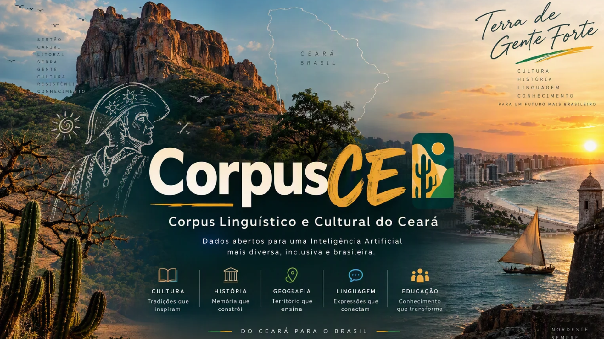

<p align="center">
  
</p>

<h1 align="center">CorpusCE</h1>

<p align="center">
  <strong>Corpus Linguístico e Cultural do Ceará</strong>
</p>

<p align="center">
  Dados abertos para Inteligência Artificial, Processamento de Linguagem Natural e pesquisa sobre o Ceará.
</p>

---

## 🌵 Sobre o CorpusCE

O **CorpusCE** é uma iniciativa aberta dedicada à coleta, organização, preservação e disponibilização de dados relacionados ao Estado do Ceará para aplicações em **Inteligência Artificial (IA)**, **Processamento de Linguagem Natural (PLN)** e pesquisa acadêmica.

O projeto busca construir uma base de dados estruturada e rastreável sobre a **linguagem, cultura, história, geografia e conhecimento produzido no Ceará**, contribuindo para uma representação mais ampla da diversidade brasileira em tecnologias de IA.

O CorpusCE não pretende ser apenas uma coleção de textos.

A proposta é construir uma infraestrutura de dados que permita, no futuro, apoiar:

- treinamento e adaptação de modelos de linguagem;
- pesquisas em português brasileiro;
- sistemas RAG;
- estudos linguísticos;
- preservação de regionalismos;
- avaliação de modelos de IA;
- desenvolvimento de datasets especializados;
- desenvolvimento de tecnologias brasileiras de IA.

---

# 🎯 Missão

Construir uma base aberta, documentada e tecnicamente reutilizável de conhecimento relacionado ao Ceará, preservando aspectos linguísticos e culturais da região e permitindo sua utilização em pesquisa e desenvolvimento tecnológico.

---

# 🔭 Visão

O CorpusCE começa pelo Ceará, mas sua arquitetura foi pensada para permitir expansão futura.

```text
CorpusCE
    │
    ▼
CorpusNordeste
    │
    ▼
CorpusBrasil
    │
    ▼
BrasilBench
    │
    ▼
Modelos de IA brasileiros
```

O objetivo de longo prazo é contribuir para um ecossistema brasileiro de dados, benchmarks e modelos de Inteligência Artificial.

---

# 🧭 Áreas do Corpus

## 🗣️ Linguagem

Coleta e documentação de elementos do português utilizado no Ceará.

Inclui:

- regionalismos;
- expressões populares;
- gírias;
- vocabulário regional;
- variações semânticas;
- formas de expressão;
- exemplos contextualizados de uso.
